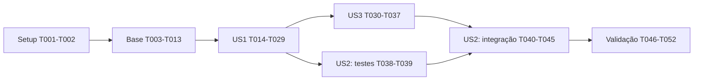

# Tasks: Recomendações diárias de livros no Painel

**Input**: [plan.md](plan.md), [spec.md](spec.md), [research.md](research.md), [data-model.md](data-model.md), [contratos](contracts/) e [quickstart.md](quickstart.md).

**Created**: 2026-10-30. **Branch**: `feature/002-recomendacoes-painel-wip`.

**Prerequisites**: decisões de produto e desenho concluídos. Java 17, MySQL 8 de teste, Node compatível com Next 16 e Docker para Testcontainers. Não existe constituição nem hook de extensão no Alexandria.

**Tests**: incluídos para verificar os cenários de aceitação e SC-001 a SC-009 da especificação. Não criar testes que apenas reproduzam a implementação; usar casos de negócio, ordenação integral de referência e concorrência real. Os testes específicos aparecem antes da implementação da respectiva história para expor a ausência do comportamento.

**Organization**: fases por prioridade: US1 (P1), US3 (P1), US2 (P2). A numeração das histórias permanece a da spec. Implementação em andamento. Marcas [X] refletem trabalho implementado e validado; evidências e limitações em [validation-results.md](validation-results.md).

## Formato e convenções de caminhos

Cada tarefa segue `- [ ] TNNN [P?] [USn?] descrição com caminho`. Caminhos são relativos à raiz do Alexandria. Tipos novos citados são alvos propostos, não arquivos que já existem.

`[P]` indica trabalho em arquivos distintos que pode ocorrer em paralelo **após concluir os pré-requisitos indicados**; não permite ignorar dependências ou editar o mesmo arquivo simultaneamente. Tarefas sem história são de setup, base ou validação transversal.

Invariantes para todas as tarefas: catálogo inteiro considerado; uma publicação READY por leitor/dia; até 30 livros; repetir a mesma seleção sem rede por volta; retirar os livros atuais da biblioteca sem reposição até o dia seguinte. Sem cursor, sorteio obrigatório, fallback popular, IA externa ou migração em ambiente compartilhado nesta fase.

## Fase 1 — Setup

**Objetivo**: preparar o ambiente e separar os executores de teste existentes.

- [X] T001 Conferir Java 17, Node >=20.9 e configuração local com base em `alexandria-backend/pom.xml`, `alexandria-frontend/package-lock.json` e `specs/002-recomendacoes-painel/quickstart.md`; instalar dependências com npm ci, ler o guia Next relevante em node_modules/next/dist/docs antes de editar código frontend e configurar NEXT_PUBLIC_API_URL no .env.local ignorado; registrar versões e bloqueios no quickstart sem segredos nem mudanças de stack. Executar o probe scripts/check-mysql-toolchain.ps1 descrito no quickstart; no ambiente validado, api.version=1.44 resolve a conexão Testcontainers/Docker. Não considerar docker version suficiente como prova de MySQL/Flyway. Baseline e limites em implementation-readiness.md.
- [X] T002 Configurar descoberta separada em `alexandria-frontend/vitest.config.ts` e criar `alexandria-frontend/playwright.config.ts` com testDir ./e2e, usando include src/**/*.test.{ts,tsx} ou exclusão equivalente no Vitest; preservar testes existentes e impedir que npm test execute Playwright em jsdom (depende de T001).

**Checkpoint**: dependências e guias acessíveis; comandos documentados reproduzíveis; suítes de navegador e unidade separadas.

## Fase 2 — Base compartilhada

**Objetivo**: fornecer modelos, portas, banco e execução usados pelas três histórias. Esta fase bloqueia a integração das histórias; tarefas marcadas podem avançar nos grupos de dependências abaixo.

- [X] T003 Criar modelos puros e invariantes em `alexandria-backend/src/main/java/com/pucsp/alexandria/domain/recommendation/` nos arquivos `CatalogBookFeatures.java`, `ReadingProfile.java`, `RecommendationCandidate.java`, `DailySelection.java` e `RecommendationBatchStatus.java`, incluindo seleção <=30, evidência positiva, position 1–30 e READY imutável; não importar Spring/JPA (depende de T001).
- [X] T004 Definir portas em `alexandria-backend/src/main/java/com/pucsp/alexandria/domain/recommendation/` nos arquivos `CatalogFeatureRepository.java`, `ReadingProfileRepository.java`, `RecommendationBatchRepository.java`, `RecommendationReadPort.java` e `RecommendationGenerationQueue.java`, separando leitura completa, claim/heartbeat/publicação, consulta filtrada e fila; contratos não devem exigir Page do frontend (depende de T003).
- [X] T005 [P] Criar `alexandria-backend/src/main/resources/db/migration/V4__create_recommendation_batches_and_items.sql` conforme data-model.md: duas tabelas, unique(user_id,reference_date), selected_count 0–30, chaves de itens/posição, índices de consulta/retomada, cascade de batch/usuário/livro e SET NULL da evidência; conferir antes se V4 permanece livre e não alterar livros/biblioteca existentes (depende de T001). Incluir automatic_attempt_count e operational_pending_since conforme modelo refinado. Incluir failed_at para cooldown manual, distinto de next_attempt_at AUTO.
- [X] T006 Mapear as novas tabelas em `alexandria-backend/src/main/java/com/pucsp/alexandria/adapter/out/persistence/entity/RecommendationBatchEntity.java`, `RecommendationItemEntity.java` e `RecommendationItemId.java`, e criar repositórios JPA/mappers correspondentes em `adapter/out/persistence/jpa/` e `adapter/out/persistence/mapper/`; persistir UTC e selected_count original, sem serializar entidades no REST (depende de T003, T005).
- [X] T007 Implementar escrita coordenada em `alexandria-backend/src/main/java/com/pucsp/alexandria/adapter/out/persistence/RecommendationBatchRepositoryImpl.java`: claim de PENDING existente/FAILED elegível/BUILDING expirado com token novo, heartbeat/FAILED somente com BUILDING+token+lease válido pelo UTC do banco e publicação de itens+READY atômica em transação curta; nunca bloquear a linha durante CPU do ranking nem permitir que token antigo grave (depende de T004, T006). Claims incrementam contadores por origem AUTO/MANUAL; incluir liberação NO_PROFILE condicional/idempotente por token para PENDING dormente sem consumir orçamento automático; limpar operational_pending_since e reiniciá-lo condicionalmente ao reativar. Normalizar lease expirado com CAS próprio BUILDING/token/lease observados para FAILED/LEASE_EXPIRED, invalidando token sem novo claim nem consumo de tentativa; worker titular continua exigindo lease válido.
- [X] T008 [P] Implementar leitura consistente do catálogo em `alexandria-backend/src/main/java/com/pucsp/alexandria/adapter/out/persistence/CatalogFeatureRepositoryImpl.java` e projeções em `adapter/out/persistence/jpa/`: ID-keyset em lotes de 500, todos os livros digitais com URL não vazia e autores em lote, sem N+1, fetch join de coleção paginada ou corte por downloads; garantir consistência de todos os lotes no MySQL (depende de T004). Fixar REPEATABLE_READ explicitamente para todos os lotes e autores na mesma transação read-only; testar alteração concorrente entre lotes sem mistura de versões.
- [X] T009 [P] Implementar leitura completa da biblioteca em `alexandria-backend/src/main/java/com/pucsp/alexandria/adapter/out/persistence/ReadingProfileRepositoryImpl.java` e projeções em `adapter/out/persistence/jpa/`, incluindo todos os vínculos, assuntos, autores, idiomas e notas 0–5 do leitor; disponibilizar paginação por userId para o dispatcher e verificação de sinal positivo sem varrer catálogo (depende de T004).
- [X] T010 Implementar consulta de seleção atual/anterior em `alexandria-backend/src/main/java/com/pucsp/alexandria/adapter/out/persistence/RecommendationReadAdapter.java` e projeções em `adapter/out/persistence/jpa/`, aplicando user_id autenticado, NOT EXISTS da biblioteca atual e disponibilidade digital tanto para READY quanto STALE; hidratar até30 livros/autores em lote, sem reposição ou alteração de posição original (depende de T004, T006).
- [X] T011 [P] Criar `alexandria-backend/src/main/java/com/pucsp/alexandria/config/RecommendationProperties.java` e `RecommendationConfiguration.java`, com Clock injetável, fuso America/Sao_Paulo, cron diário 00h, recuperação 5min, lease 5min/heartbeat 60s, retry 60s/300s, executor dedicado de dois trabalhadores/fila100 e shutdown controlado; documentar as propriedades em `alexandria-backend/src/main/resources/application.properties` sem usar o executor Gutendex nem incluir segredos (depende de T004). Separar scheduler de heartbeat e executor de controle (um controlador, gatilhos coalescidos por data) dos workers; scheduler só submete e retorna, sem descoberta/backpressure nele. Validar heartbeat >0 e <lease; cancelar renovações em finally e encerrar todos os executores.
- [X] T012 Criar e executar `alexandria-backend/src/test/java/com/pucsp/alexandria/adapter/out/persistence/RecommendationPersistenceIntegrationTest.java` com MySQL Testcontainers e Flyway habilitado: validar cadeia de migrações/V4, constraints, dois claims concorrentes, token vencido sem ressurreição, retomada de PENDING, rollback da publicação, exclusão atual e CASCADE/SET NULL; provar ausência de publicação parcial e no máximo uma READY por usuário/data (depende de T005 a T010). Cobrir contadores atômicos, liberação NO_PROFILE por token e claim antigo impedido após rollover. Cobrir CAS de expiração contra heartbeat/publicação/novo claim, mesmo com orçamento AUTO esgotado. Usar opção de JVM api.version=1.44 quando necessária neste ambiente, conforme quickstart; não ignorar testes se Docker falhar. Validar tanto banco vazio até V4 quanto upgrade V3→V4 com usuários/biblioteca semeados, comprovando preservação dos dados existentes.
- [X] T013 [P] Criar fixtures isoladas em `alexandria-backend/src/test/java/com/pucsp/alexandria/support/RecommendationFixtures.java`, com >30 candidatos distribuídos ao longo do catálogo, biblioteca maior que uma página, notas 0/1/3/4/5, metadados incompletos, várias contas e Clock controlado; não adicionar endpoint de seed nem usar dados de produção (depende de T003).

**Checkpoint**: persistência e leitura completa disponíveis; T012 verde no MySQL, não só H2. Não integrar as histórias com claim/publicação simulados em produção.

## Fase 3 — US1: Descobrir livros compatíveis com meus interesses (P1)

**Objetivo**: formar o perfil, escolher até30 livros a partir de toda a base, gerar uma primeira seleção diária e exibi-la no Painel com motivos reais.

**Teste independente**: usar biblioteca/catálogo controlados, disparar primeira geração pelo acesso/POST e verificar resultado igual ao top-30 da ordenação integral de referência, exclusão de todas as páginas da biblioteca, justificativas e isolamento entre contas. A seleção pode ser demonstrada sem o cron global nem ações de inclusão direta; o ciclo completo é finalizado na US3.

### Testes da história

- [X] T014 [P] [US1] Escrever casos de normalização e sinais em `alexandria-backend/src/test/java/com/pucsp/alexandria/domain/recommendation/ReadingProfileTest.java`, cobrindo delimitadores ; e vírgula, Unicode NFKC, deduplicação, autores por ID, maior peso por característica, notas baixas/zero e ausência de sinais sem usar data de criação como conclusão (depende da Fase 2).
- [X] T015 [P] [US1] Escrever testes de ordenação em `alexandria-backend/src/test/java/com/pucsp/alexandria/domain/recommendation/RecommendationScorerTest.java`, comparando heap top-30 com uma ordenação integral independente, candidatos fortes no fim da base, prioridades 4/3/2/1, desempates, menos de30, metadados nulos e rejeição de coincidência apenas por idioma/popularidade (depende da Fase 2). Cobrir empate de motivo entre assuntos/autores com ordens de entrada diferentes, conforme desempate explícito de research.md.
- [X] T016 [P] [US1] Escrever testes de contrato em `alexandria-backend/src/test/java/com/pucsp/alexandria/adapter/in/rest/RecommendationControllerIntegrationTest.java` para GET/POST do OpenAPI: JWT, no-store, <=30 IDs únicos, sem userId de cliente, seleção do dia/anterior, EMPTY/GENERATING, 202/503/429, idempotência de READY, isolamento entre leitores e precedência READY de hoje -> NO_PROFILE sem seleção atual -> eventual STALE, incluindo seleção antiga com perda de sinais positivos no novo dia; não exigir JSON uniforme no 401 existente (depende da Fase 2). Cobrir generationStatus declarado e obrigatório, STALE com zero itens, schema 503 dedicado exigindo generationStatus/retryAfterSeconds, FAILED versus IDLE, no-store em GET/POST/erros controlados e CORS com Origin permitido expondo Retry-After.
- [X] T017 [P] [US1] Escrever testes do carregamento em `alexandria-frontend/src/hooks/useRecommendations.test.tsx`, usando helpers existentes e API mockada, para estados iniciais, EMPTY/STALE, 202 com Retry-After, limite de10 polls, falha preservando itens e limpeza ao trocar usuário/logout (depende de T002 e da Fase 2). Cobrir STALE originalmente vazia/filtrada, Verificar atualização via GET e FAILED com cooldown; NO_PROFILE não presume biblioteca vazia.

### Implementação da história

- [X] T018 [US1] Implementar `alexandria-backend/src/main/java/com/pucsp/alexandria/domain/recommendation/RecommendationFeatureNormalizer.java` com as regras exatas de research.md, mantendo frases completas dos assuntos, acentos e --, separando idiomas e sem inventar traduções ou taxonomia (depende de T014).
- [X] T019 [US1] Implementar `alexandria-backend/src/main/java/com/pucsp/alexandria/domain/recommendation/ReadingProfileBuilder.java`, usando todos os vínculos e máximo peso/evidência por feature, pesos done4–5=4/reading=3/toread=2/done3=1/done0–2=0 e bookId menor como desempate de evidência (depende de T018).
- [X] T020 [US1] Implementar `alexandria-backend/src/main/java/com/pucsp/alexandria/domain/recommendation/RecommendationScorer.java` e `RecommendationSelector.java`, com elegibilidade Smax>0 ou Amax>0, tupla inteira Smax/Smean/Amax/Amean/Lmax/downloadCount/bookId de research.md, justificativa positiva e heap de até30 que avalia todos os registros; sem teto por autor ou fallback popular (depende de T015, T019). Desempatar motivo por chave normalizada de assunto (String.compareTo) ou authorId crescente; evidência por bookId crescente, sem depender da ordem de Set/Map.
- [X] T021 [US1] Implementar `alexandria-backend/src/main/java/com/pucsp/alexandria/adapter/out/persistence/RecommendationCatalogSnapshotProvider.java`, compartilhando uma única projeção compacta por execução/processo/referenceDate, construção single-flight, checksum determinístico e liberação ao concluir; falha na leitura completa não publica catálogo parcial nem faz download de EPUB (depende de T008, T018). Usar sessão compartilhada imutável com handles e contagem de consumidores; testar cron/recovery/GET sobrepostos, single-flight e liberação apenas após último consumidor. Manter proprietário por execução e tarefas registradas antes da submissão; construção preguiçosa, conservar sessão entre ondas e liberar só após descoberta encerrada + todas tarefas/handles concluídos; teste com 2 workers/6 leitores e barreira prova uma varredura. Identificar sessão por referenceDate: só compartilhar entre trabalhos da mesma data; novo dia usa projeção nova sem invalidar handles antigos. Acrescentar teste de virada com alteração do catálogo e medir pico da sobreposição entre datas.
- [X] T022 [US1] Implementar `alexandria-backend/src/main/java/com/pucsp/alexandria/application/recommendation/GenerateDailyRecommendationsUseCase.java`, usando referenceDate imutável do PENDING, lendo perfil completo, consumindo snapshot compartilhado e publicando resultado READY imutável (inclusive zero itens), com heartbeat válido e falha sanitizada; cálculo fora de transação de escrita (depende de T007, T009, T020, T021). referenceDate vem do PENDING, não do relógio do claim. Revalidar perfil antes do catálogo: sem sinais liberar PENDING dormente sem READY/falha e reverter consumo AUTO por token.
- [X] T023 [US1] Implementar `alexandria-backend/src/main/java/com/pucsp/alexandria/application/recommendation/RequestDailyRecommendationGenerationUseCase.java` e `adapter/in/job/RecommendationGenerationWorker.java`, usando executor dedicado, claim apenas ao iniciar trabalho, registrando PENDING/created_at antes de aguardar fila sem adquirir lease, coalescendo pedidos repetidos e respeitando capacidade/backoff; reutilizar READY, responder NO_PROFILE sem ranking e iniciar primeira geração do dia de forma assíncrona (depende de T011, T022). Propagar origem AUTO/MANUAL explicitamente, capturar data ao criar PENDING, coalescer sem promover AUTO a MANUAL e aplicar contadores/limites atomicamente no claim.
- [X] T024 [US1] Implementar `alexandria-backend/src/main/java/com/pucsp/alexandria/application/recommendation/GetRecommendationsUseCase.java` e DTOs em `application/recommendation/dto/`, aplicando estritamente a precedência READY de hoje (inclusive vazia) -> sem READY de hoje verificar perfil atual (EMPTY/NO_PROFILE sem geração nem fallback se não houver sinais) -> com sinais solicitar/retomar geração e usar anterior STALE, 202 sem anterior ou 503 em falha; diferenciar NO_PROFILE/NO_MATCHES/ALL_ADDED_OR_UNAVAILABLE e nunca reconstruir READY por consulta (depende de T010, T023). GET usa AUTO; não ultrapassar três claims automáticos. Expor generationStatus e matriz STALE vazia/503 para ações de GET versus POST. Normalizar BUILDING expirado antes de classificar resposta, sem usar ALREADY_RUNNING para lease vencido.
- [X] T025 [US1] Implementar `alexandria-backend/src/main/java/com/pucsp/alexandria/adapter/in/rest/recommendation/RecommendationController.java`, responses do OpenAPI e beans em `alexandria-backend/src/main/java/com/pucsp/alexandria/config/BeanConfiguration.java`, com GET /recommendations e POST /recommendations/generation sem corpo; obter identidade do principal JWT, Retry-After/no-store e erros compatíveis no handler, sem alterar o gate de assinatura (depende de T016, T024). Ajustar CorsConfig.java efetivo para expor Retry-After; verificar integração Spring Security e no-store em respostas controladas GET/POST/erro.
- [X] T026 [P] [US1] Adicionar DTOs compactos e funções getRecommendations/requestRecommendationGeneration em `alexandria-frontend/src/lib/api.ts`, propagando AbortSignal e status/Retry-After via apiFetch existente; não exigir BookApiResponse completo para o livro recomendado e preservar tratamento JWT (depende de T016 e contrato em contracts/recommendations.openapi.yaml; pode ocorrer enquanto T018–T025 são implementadas). Transportar generationStatus e cooldown de erro 503; não inferir elegibilidade de retry pelo texto da mensagem.
- [X] T027 [US1] Implementar `alexandria-frontend/src/hooks/useRecommendations.ts` para consumir a seleção inteira e lidar com os estados do contrato, polling limitado, retry POST somente quando cabível, abort/request-generation e troca de conta; nenhuma consulta por cartão ou volta (depende de T017, T026). Usar generationStatus para Verificar atualização (GET) versus retry explícito de FAILED (POST), inclusive STALE sem itens; respeitar cooldown.
- [X] T028 [P] [US1] Criar `alexandria-frontend/src/components/recommendations/RecommendationCard.tsx` com capa/substituto, título/autores, motivo e link /explorar/{id}, data de evidência e leitura acessível sem hover; adaptar getAuthorDisplay em `alexandria-frontend/src/lib/api.ts` apenas após T026, se necessário para aceitar os campos mínimos (depende de T026). Usar selection.referenceDate como data da seleção, nunca data de avaliação; motivo histórico sem afirmar gosto/status atual.
- [X] T029 [US1] Integrar `alexandria-frontend/src/components/recommendations/RecommendationSection.tsx` e `alexandria-frontend/src/app/(main)/dashboard/page.tsx` após Lendo Agora, com até30 itens, estados vazios/gerando/STALE/falha independentes e acesso a Explorar; executar T014–T017 e conferir detalhes/justificativas com duas contas sem afetar estatísticas existentes (depende de T025, T027, T028).

**Checkpoint**: US1 demonstra recomendação personalizada e primeira seleção diária durável. Não apresentar este incremento como feature final: o agendamento/recuperação/ciclo da US3 e a inclusão imediata da US2 ainda precisam ser entregues.

## Fase 4 — US3: Navegar pela seleção diária em ciclos (P1)

**Objetivo**: processar diariamente, recuperar falhas/reinícios e repetir a seleção pronta sem rede por volta.

**Teste independente**: com geração testável e fixture READY, avançar mil voltas, verificar <=30 itens/DOM estável e nenhum job/GET por volta; simular dia seguinte, worker perdido e falha para verificar uma publicação, recuperação e fallback filtrado. Não depende das ações da US2; biblioteca pode ser modificada por fixtures/API existente.

### Testes da história

- [X] T030 [P] [US3] Escrever `alexandria-backend/src/test/java/com/pucsp/alexandria/application/recommendation/DailyRecommendationGenerationTest.java` para fuso/virada de dia com Clock, seleção vazia imutável, cron perdido, recuperação de PENDING/lease expirado, máximo de3 tentativas automáticas/backoff, READY de hoje preservada após mudança de perfil e novo dia sem sinais retornando NO_PROFILE mesmo com seleção antiga; ampliar a integração MySQL de T012 só de forma sequencial quando houver casos de transação novos (depende da US1). Testar fila PENDING atravessando meia-noite, worker iniciado ontem terminando sob data original, cem GETs após três falhas sem novo claim, POST elegível e perda de sinais após PENDING seguida de novos sinais no mesmo dia. Incluir terceiro crash AUTO, lease expirado normalizado para FAILED sem quarto claim, 503/STALE acionável e POST MANUAL após failed_at+60s; provar READY única. Testar workers/fila saturados sem impedir heartbeat e progresso de descoberta; cron apenas dispara, não bloqueia o scheduler. Testar cancelamento/shutdown sem renovações ou threads órfãs, com tempo/barreiras controlados.
- [X] T031 [P] [US3] Escrever `alexandria-frontend/src/components/recommendations/RecommendationCarousel.test.tsx` com 0/1/7/30 itens, wrap só após esgotar a volta, mil voltas sem requisições/clones, índice válido após mudança da lista e teclado/gesto sem autoplay (depende da US1). Um cartão visível em celular/desktop, indicador por itens elegíveis, ocultos fora do foco/leitura, Anterior permite rever e um item pode se reapresentar.

### Implementação da história

- [X] T032 [US3] Criar `alexandria-backend/src/main/java/com/pucsp/alexandria/adapter/in/job/DailyRecommendationDispatcher.java`, cron diário configurável default00h America/Sao_Paulo e recuperação no startup, percorrendo leitores elegíveis por ID em lotes e usando o mesmo pedido/worker sem claims enfileirados ou descartes silenciosos; reutilizar snapshot por execução (depende de T030, T023). Capturar data antes da fila, não iniciar claims antigos; usar sessão de snapshot compartilhada e checar sinais antes de ofertar PENDING dormente. Registrar proprietário e tarefas da execução antes da submissão, inclusive enquanto fila/perfil aguardam; liberar registros em finally ou rejeição. Descoberta/espera por capacidade roda no executor de controle de T011, sem ocupar scheduler nem worker de ranking; coalescer gatilhos por data.
- [X] T033 [US3] Criar `alexandria-backend/src/main/java/com/pucsp/alexandria/adapter/in/job/RecommendationRecoveryJob.java` e consultas de retomada em `adapter/out/persistence/RecommendationBatchRepositoryImpl.java`, executando a cada5min, retomando PENDING/FAILED elegível/BUILDING expirado, aplicando token novo/backoff/limite automático e sem reprocessar READY ou publicar sob data errada (depende de T032). AUTO não excede orçamento; ignorar headers antigos, assegurar cobertura de leitores elegíveis sem header de hoje e não reofertar PENDING sem sinais. Normalizar BUILDING expirado mesmo com orçamento esgotado; aplicar failed_at/cooldown manual separado de next_attempt_at AUTO.
- [X] T034 [US3] Implementar retenção em `alexandria-backend/src/main/java/com/pucsp/alexandria/adapter/in/job/RecommendationRetentionJob.java` e consultas no repositório de batches, mantendo duas últimas READY por leitor após sucesso e limpando PENDING/FAILED e BUILDING antigo com lease vencido após7dias em lotes curtos; preservar última válida e qualquer lease ativo; validar cascades e concorrência com publicação (depende de T033).
- [X] T035 [US3] Instrumentar `alexandria-backend/src/main/java/com/pucsp/alexandria/adapter/in/job/RecommendationMetrics.java` e pontos de integração do worker/dispatcher de forma sequencial, com Micrometer/Actuator existentes: duração, filas, falhas, retries, idade da READY e livros analisados/selecionados; sem userId em labels ou dados privados/tokens nos logs; ampliar RecommendationProperties com limiar configurável default60min e checagem5min; emitir WARN agregado com referenceDate, quantidade de leitores pendentes e idade da pendência mais antiga (operational_pending_since de PENDING, reiniciado após dormência, não a meia-noite), no máximo uma vez por hora por instância/data; não avisar fila sem atraso nem integrar notificação externa. Excluir do WARN headers antigos e PENDING dormente sem perfil positivo; testar explicitamente esses filtros e reativação após dormência longa com reinício de operational_pending_since, sem aviso imediato. Criar e executar `alexandria-backend/src/test/java/com/pucsp/alexandria/adapter/in/job/RecommendationMetricsTest.java` com tempo controlado para limiar, campos sanitizados, supressão por uma hora e recuperação; documentar diagnóstico no quickstart (depende de T034; integrar métricas depois das alterações de recuperação/retenção para não disputar os mesmos arquivos).
- [X] T036 [P] [US3] Implementar `alexandria-frontend/src/components/recommendations/RecommendationCarousel.tsx` e integrá-lo em `RecommendationSection.tsx`, com índice modular, até30 cartões, botões anterior/próximo, gesto com wrap, foco e anúncios acessíveis; fim reinicia a mesma lista sem rede, timer, autoplay ou acumular clones (depende de T031; independente do backend T032–T035). Default um cartão visível, passo unitário e indicador X de N, hidden/desmontagem dos demais; validar Tab sem alcançar cartões ocultos.
- [X] T037 [US3] Criar e executar `alexandria-frontend/e2e/recommendations-daily.spec.ts` e concluir os testes de T030–T031, provando geração/READY reutilizada em recarga, zero requisições por volta, EMPTY sem reposição, STALE com data verdadeira e rollover por relógio/fixture de teste; usar backend/seed isolados, nunca expor endpoint público de clock/seed (depende de T029, T033, T034, T036). Verificar STALE vazio, conclusão via Verificar atualização GET, leitura real de Retry-After entre origens e cooldown respeitado no navegador.

**Checkpoint**: US1+US3 entregam seleção diária e consulta cíclica confiável. São o MVP de descoberta para demonstração; a feature solicitada só fica completa com a retirada imediata após inclusão da US2.

## Fase 5 — US2: Explorar e guardar uma recomendação (P2)

**Objetivo**: reutilizar a inclusão da biblioteca, retirar imediatamente o livro de todas as sugestões e impedir que respostas atrasadas o restaurem, sem gerar substituto.

**Teste independente**: adicionar uma sugestão com um GET anterior artificialmente atrasado, navegar/recarregar e conferir um vínculo toread e ausência em todas as voltas; testar duplicidade/erro e esgotar os selecionados. Usar seleção READY de fixture sem depender da execução do cron.

### Testes da história

- [X] T038 [P] [US2] Escrever teste MySQL concorrente em `alexandria-backend/src/test/java/com/pucsp/alexandria/adapter/in/rest/RecommendationLibraryConsistencyIntegrationTest.java` para duas inclusões simultâneas, um único vínculo/409 na duplicada e GET filtrando READY/STALE; usar confirmações transacionais reais e não depender só de H2/fixtures não commitadas (depende da US1 e T012).
- [X] T039 [P] [US2] Escrever `alexandria-frontend/src/hooks/useRecommendations.library.test.tsx` e `src/components/recommendations/RecommendationCard.test.tsx` para sucesso, falha, 409, clique duplicado, GET antigo após confirmação, retirada de todos, remoção posterior da biblioteca e troca de conta; preparar respostas controladas/atrasadas (depende da US1 e T036). Distinguir BOOK_NOT_FOUND confirmado de 404 genérico/rede/5xx; confirmar retirada, foco e vazio do último cartão sem reposição.

### Implementação da história

- [X] T040 [US2] Ajustar `alexandria-backend/src/main/java/com/pucsp/alexandria/adapter/out/persistence/UserBooksRepositoryImpl.java` e, se necessário, `advice/GlobalExceptionHandler.java` para traduzir a violação concorrente da unicidade user_books(user_id,book_id) em DuplicateUserBooksException/409; não converter qualquer erro de integridade em duplicidade nem acoplar gravação da biblioteca à geração de recomendações (depende de T038). Acrescentar código opcional BOOK_NOT_FOUND à resposta de BookNotFoundException em GlobalExceptionHandler/ErrorResponse, preservando campos atuais; testar POST /user-books com livro ausente. Não mapear qualquer 404 ou integridade para indisponibilidade.
- [X] T041 [P] [US2] Criar `alexandria-frontend/src/lib/library-events.ts` e emitir invalidação após mutações confirmadas em `alexandria-frontend/src/lib/api.ts`, incluindo add/update/remove; manter contratos existentes, não emitir sucesso em falha e transportar entre abas apenas invalidação se BroadcastChannel/storage forem usados (depende de T026, T039; não editar api.ts simultaneamente com T028). Preservar status/código de erro do addUserBook mantendo compatibilidade com already_added e demais consumidores.
- [X] T042 [P] [US2] Adicionar inclusão em `alexandria-frontend/src/components/recommendations/RecommendationCard.tsx` e callback da seção, usando addUserBook existente com estado pendente só no cartão, sucesso confirmado, 409 como já existente e erro com retry; manter ação sempre disponível em teclado/celular e foco válido após retirar cartão (depende de T039, T028; paralelo a T041 somente sem editar arquivos compartilhados). Em BOOK_NOT_FOUND, informar indisponibilidade, retirar cartão e revalidar GET com foco válido; em erro não classificado manter cartão/retry, salvo exclusão confirmada pelo GET.
- [X] T043 [US2] Atualizar `alexandria-frontend/src/hooks/useRecommendations.ts` e `src/components/recommendations/RecommendationSection.tsx` para remover bookId de todas as ocorrências após sucesso/409, cancelar GET anterior, ignorar gerações de resposta antigas e filtrar IDs confirmados até revalidar; não chamar POST de geração nem repor ao adicionar; manter índice/foco do carrossel coerentes quando a lista encolhe (depende de T041, T042).
- [X] T044 [US2] Integrar eventos e revalidação em `alexandria-frontend/src/hooks/useRecommendations.ts` no mount/retorno/foco e após mutações em detalhe/biblioteca via api.ts, com limpeza de listeners e abort no logout; uma remoção explícita da biblioteca deve permitir reexibir o livro se já estiver na seleção diária, sem recalcular afinidade nem manter supressão permanente (depende de T043).
- [X] T045 [US2] Criar e executar `alexandria-frontend/e2e/recommendations-library.spec.ts` e rodar T038–T039 para teclado/mobile390px, detalhes/retorno, sucesso, duplicidade, falha sem falsa confirmação, respostas atrasadas e inclusão de todos os selecionados; confirmar EMPTY sem reposição até o próximo dia e ausência após recarga (depende de T037, T040, T044). Cobrir livro removido após carregar seleção, 404 genérico sem falsa remoção, 5xx transitório e último cartão indisponível com vazio/foco válido.

**Checkpoint**: as três histórias completas atendem descoberta, geração diária/ciclo e inclusão com retirada imediata. Mudar status/nota não reconstrói READY do dia.

## Fase 6 — Validação transversal e documentação

**Objetivo**: comprovar requisitos e limites no ambiente de referência, sem alegar desempenho/usabilidade com base apenas nos testes automatizados.

- [X] T046 [P] Atualizar `alexandria-backend/markdown/ARCHITECTURE.md` e `HOW_TO_ADD_NEW_DOMAIN.md` com os componentes que efetivamente foram implementados, e `specs/002-recomendacoes-painel/quickstart.md` com propriedades/comandos finais e restrições; documentar Flyway real e retenção sem apresentar proposta como código existente (depende de T045).
- [X] T047 [P] Conferir contrato runtime contra `specs/002-recomendacoes-painel/contracts/recommendations.openapi.yaml`, `contracts/dashboard.md` e `contracts/daily-generation.md`, usando os testes REST e E2E: estados, selectedCount original, campo selection nulo válido, no-store, Retry-After, IDs privados não expostos e ausência de fallback/recálculo por navegação; registrar divergências e corrigir código/contrato preservando a spec (depende de T045). Compilar schemas OpenAPI adaptando nullable para JSON Schema; detectar ciclos allOf e testar 503 válido, ausência de campos obrigatórios e estado inválido.
- [X] T048 Executar verificações completas previstas em `specs/002-recomendacoes-painel/quickstart.md`: mvnw test, integração MySQL/Flyway, npm run lint, npm test, npm run build e npm run test:e2e; registrar comandos/resultados e impedir que falta de Docker/suíte ou teste ignorado seja relatado como aprovação (depende de T046, T047).
- [X] T049 Preparar um ensaio reproduzível e isolado em `alexandria-backend/src/test/java/com/pucsp/alexandria/performance/RecommendationCapacityTest.java` e instruções em `specs/002-recomendacoes-painel/quickstart.md`, com perfil opt-in para não carregar toda a suíte comum:100mil livros, mil leitores, até mil vínculos por biblioteca e 50 leituras simultâneas, seed determinístico e validação do top-30 contra referência; criar também `alexandria-frontend/e2e/recommendations-performance.spec.ts` opt-in, observação de render instalada antes da navegação, navigation.startTime até cartões/EMPTY visíveis após duas requestAnimationFrame em build de produção, cinco aquecimentos e >=100 amostras válidas por perfil com seleção pronta; excluir skeleton/GENERATING como fim, registrar falhas e não descartar medições lentas; nunca aplicar carga em produção (depende de T046; preparar o ensaio depois da atualização documental para não disputar quickstart.md).
- [X] T050 Executar o ensaio de T049 e registrar evidências em `specs/002-recomendacoes-painel/validation-results.md`: p95 de exibição no navegador <=2s com seleção pronta pelo método nearest-rank, amostras individuais, cinco aquecimentos, >=100 válidas por perfil, falhas/timeouts reportados e resolvidos antes da aprovação, navegador/versão, máquina, viewport, rede/cache e 50 leitores concorrentes; medir separadamente a meta de engenharia de mil leitores gerados em <=60min, quantidade integral de livros avaliados, EXPLAIN, CPU/heap/RSS/GC, I/O/locks, retenção e reinício/fallback; otimizar se necessário sem truncar catálogo; se ambiente indisponível, deixar pendente com motivo (depende de T048, T049).
- [X] T051 Registrar em `specs/002-recomendacoes-painel/validation-results.md` a dispensa explícita do teste humano SC-007 pelo usuário em 2026-10-30, incluindo a sessão qualitativa do top-5: o usuário prefere iterar depois. Não executar nem alegar aprovação com cinco participantes. Concluir esta tarefa documental após confirmar os testes automatizados de teclado, 390px, desktop, justificativas e inclusão de T045/T048; esses requisitos permanecem obrigatórios (depende de T045, T048).
- [X] T052 Revisar cobertura FR-001 a FR-017 e SC-001 a SC-009 em `specs/002-recomendacoes-painel/tasks.md` e `validation-results.md`, atualizar status real e registrar o que ficou de fora/com motivo, confirmar branch feature/002-recomendacoes-painel-wip e ausência de segredos; não declarar feature completa com validação necessária pendente nem fazer push/deploy como parte desta tarefa (depende de T046 a T051).

## Dependências e ordem de execução

### Entre fases e histórias

A ordem padrão dos checkpoints é Setup → Base → US1/P1 → US3/P1 → US2/P2 → validação. Não presumir independência de histórias que editam hook/seção/API compartilhados. Os testes de US2 podem ser preparados após os pré-requisitos indicados; integração de UI deve aguardar o carrossel da US3.

### Dependências da base

T003 → T004. T005 pode ser preparado junto com T003/T004; T006 depende de T003+T005. Após T004, leituras de catálogo (T008), perfil (T009) e configuração (T011) têm arquivos independentes. T007/T010 usam T006; T012 exige implementação efetiva desses adapters e a migração. T013 depende apenas dos tipos de T003.

### Dentro de cada história

Preparar testes específicos → modelos/algoritmo → orquestração/adapters → endpoint/cliente → integração visual → checkpoint executado. Testes preparados antes do comportamento podem inicialmente falhar; só concluir a história quando passarem com implementação real e, para concorrência/migração, MySQL.

### Regras de avanço

Uma dependência expressa como intervalo (por exemplo T005 a T010) exige todas as tarefas desse intervalo. Um item com várias condições exige todas, salvo indicação expressa de caminho alternativo. Não criar wrappers/rotas temporárias públicas para demonstrar a história; usar fixtures e pontos de entrada de teste.

## Exemplos de execução paralela

- **Base**: após T004, T008 (catálogo), T009 (biblioteca) e T011 (configuração) podem ser preparados em arquivos distintos; alterações em repositórios compartilhados devem ser serializadas.
- **US1**: T014, T015, T016 e T017 cobrem arquivos de teste distintos após a base. T026 pode seguir o contrato enquanto T018–T025 avançam no backend. T028 aguarda T026 e não pode disputar api.ts com outro trabalho.
- **US3**: após T030/T031, o backend T032–T035 e o carrossel T036 podem avançar em paralelo; T033/T034/T035 devem coordenar edições no worker/repositório. Testes de integração do mesmo arquivo de T012 não são divididos entre editores simultâneos.
- **US2**: T038 e T039 são suítes distintas. T041 (eventos/API) e T042 (cartão) podem avançar após seus testes, sem editar seção/hook até a integração T043; T044 segue T043.

Estes exemplos são oportunidades de trabalho, não instrução para iniciar agentes ou implementar durante a geração deste documento.

## Estratégia de implementação

1. Entregar Setup/Base e validar MySQL. Não substituir leases/transações por mocks no sistema real.
2. Entregar US1 como descoberta demonstrável com primeira geração do dia, seleção persistida e justificativas reais.
3. Acrescentar US3 para o **MVP de descoberta diária**: seleção de até30 repetida localmente, job diário, recuperação e fallback. Não prometer funcionalidade de inclusão imediata antes da US2.
4. Entregar US2 para completar o fluxo solicitado de adicionar e retirar a sugestão.
5. Concluir validação transversal, incluindo evidências de capacidade e o registro da dispensa do aceite humano pelo usuário, antes de afirmar que os critérios vigentes foram atendidos.

Não iniciar infraestrutura distribuída externa, IA, cadastro local ou substituição intradiária. O usuário autorizou posteriormente um único commit local do avanço em 2026-10-30; push/deploy continuam fora do escopo. Ao executar tarefas futuramente, atualizar as caixas somente após implementação e validação correspondentes, com notas em português sobre decisões, resultado e limitações.

## Rastreabilidade de requisitos

| Requisitos/critérios | Tarefas principais |
| --- | --- |
| FR-001, FR-007, FR-008, FR-015 | T025–T029, T036–T037, T042–T045 |
| FR-002, FR-003, FR-004, FR-005, FR-012 | T008–T009, T013–T015, T018–T022 |
| FR-006, FR-010 | T005–T007, T020–T024, T030, T032–T037 |
| FR-009, FR-016 | T010, T031, T036–T045 |
| FR-011, FR-013 | T016–T017, T023–T029, T030–T037 |
| FR-014 | T010, T016–T017, T025, T027, T039, T044, T047 |
| FR-017 | T005–T007, T012, T022–T024, T030, T032–T035 |
| SC-001, SC-002, SC-003, SC-004 | T012–T016, T020–T025, T029–T031, T037 |
| SC-005, SC-008, SC-009 | T016–T017, T030–T045, T047–T048 |
| SC-006 | T049–T050 |
| SC-007 | T045, T051 |

## Resumo da geração

52 tarefas: Setup 2; Base 11; US1 16; US3 8; US2 8; validação/documentação 7. As 52 tarefas foram concluídas nesta execução; T051 registra a dispensa explícita do aceite humano pelo usuário. Evidências e limites em [validation-results.md](validation-results.md).
